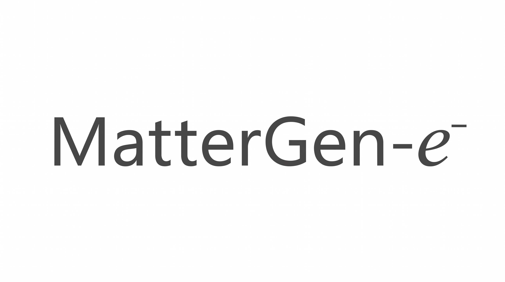

<h1>
<p align="center">
    
</p>
</h1>

<h4 align="center">

[](https://arxiv.org/abs/2605.01286)
[](https://doi.org/10.48550/arXiv.2605.01286)
[](https://python.org/downloads)
</h4>

**MatterGen-e-** extends [MatterGen](https://github.com/microsoft/mattergen) so that it generates a **per-atom electronic descriptor together with the crystal structure**: the atom-projected density of states (ADOS) or the Bader charge is denoised jointly with the lattice, the atomic positions and the atomic numbers. It is the reference implementation of *Inverse Materials Design via Joint Generation of Crystal Structures and Local Electronic Descriptors* ([arXiv:2605.01286](https://arxiv.org/abs/2605.01286)).

> [!IMPORTANT]
> This repository is a modified version of [microsoft/mattergen](https://github.com/microsoft/mattergen), based on a snapshot of the upstream repository taken in September 2025. The original work is Copyright (c) Microsoft Corporation, the modifications are Copyright (c) 2025-2026 [nmdl-mizo](https://github.com/nmdl-mizo), and both are released under the [MIT License](LICENSE). This repository is not affiliated with or endorsed by Microsoft.

## Installation

```bash
git clone https://github.com/nmdl-mizo/mattergen-e-.git
cd mattergen-e-
pip install uv
uv venv .venv --python 3.10
source .venv/bin/activate
uv pip install -e .
```

## Differences from upstream MatterGen

- **Joint generation of a per-atom electronic descriptor** (ADOS or Bader charge); see [below](#joint-generation-of-the-local-electronic-structure).
- **Dependencies built against CUDA 12.8**, for recent GPUs such as the NVIDIA RTX 6000 series.
- **[`mattergen-evaluate-un`](#evaluation-mattergen-evaluate-un)** replaces upstream's `mattergen-evaluate` and reports uniqueness and novelty without relaxation.
- **Checkpoints are distributed through the Hugging Face Hub** instead of Git LFS.

For anything not covered here, refer to the [MatterGen README](https://github.com/microsoft/mattergen#readme).

## Pre-trained checkpoints

```bash
export MODEL_NAME=atomic_dos_joint_model

huggingface-cli download oib12/nmdl-mattergen-e \
  --include "$MODEL_NAME/*" \
  --local-dir checkpoints
```

| Model | Jointly generated quantity | Training dataset | Sampling config |
|---|---|---|---|
| `atomic_dos_joint_model` | ADOS latent (30 per atom) | `mp-20-curated` | `ados-joint` |
| `atomic_dos_joint_model_finetuned` | ADOS latent (30 per atom) | `mp-20-curated` | `ados-joint` |
| `atomic_dos_joint_model_mp_20` | ADOS latent (30 per atom) | `mp-20` | `ados-joint` |
| `bader_charge_joint_model` | Bader charge | `mp-20-curated` | `chg-joint` |
| `bader_charge_joint_model_finetuned` | Bader charge | `mp-20-curated` | `chg-joint` |

The `_finetuned` models add a property-conditioning adapter (formation energy, energy above hull, DFT band gap). `atomic_dos_joint_model` is the model used in the paper; `atomic_dos_joint_model_mp_20` is recommended for DOS generation.

## Joint generation of the local electronic structure

The descriptor is a per-atom field (a *site structure*) that is diffused alongside `pos` and `atomic_numbers`:

| Name | Config | Per-atom shape | Sampling |
|---|---|---|---|
| `atomic_dos` | `ados-joint` | `(30,)` | VP-SDE |
| `bader_charge` | `chg-joint` | `()` | VP-SDE with an optional charge-neutrality constraint |

### Generating with a released model

```bash
export RESULTS_PATH=results/atomic_dos_joint_model

mattergen-generate $RESULTS_PATH \
  --model_path=checkpoints/atomic_dos_joint_model \
  --sampling_config_name=ados-joint \
  --batch_size=16 \
  --num_batches=1

unzip $RESULTS_PATH/generated_crystals_cif.zip -d $RESULTS_PATH/generated_crystals_cif
```

> [!IMPORTANT]
> Pair each model with its own sampling config from [`sampling_conf/`](sampling_conf) (`ados-joint`, `chg-joint`, or `baseline` for a model without a joint field). It supplies the predictor, the corrector and the initialisation of the per-atom field, none of which is stored in the checkpoint. MatterGen-e- models are loaded with `--model_path`; `--pretrained_name` only knows the upstream models.

The per-atom values are written to the CIFs as site properties (a vector is split into one property per component, `atomic_dos_0` … `atomic_dos_29`) and to `generated_crystals.extxyz` as per-atom columns.

> [!WARNING]
> pymatgen drops unknown `_atom_site_*` columns, so `Structure.from_file(...).site_properties` comes back empty. Read the values with `read_latents`, which returns them in the site order of the parsed structure:
>
> ```python
> from pathlib import Path
> from mattergen.decode_ados.cif_latents import read_latents
>
> values, records = read_latents([Path("gen_0.cif")], "atomic_dos", 30)
> ```

### Decoding the ADOS (`mattergen-decode-ados`)

The 30 values per atom are the latent vector of a convolutional autoencoder, not a spectrum. Download the autoencoder that matches the model and decode:

```bash
huggingface-cli download oib12/nmdl-mattergen-e_atomic-dos-autoencoder \
  --include "mp_20_curated_-15eV_to_5eV_30dim.pt" \
  --local-dir autoencoder

mattergen-decode-ados \
  --structures_dir $RESULTS_PATH/generated_crystals_cif \
  --autoencoder_path autoencoder/mp_20_curated_-15eV_to_5eV_30dim.pt \
  --output_npz decoded_ados.npz
```

| Autoencoder | Use with |
|---|---|
| `mp_20_curated_-15eV_to_5eV_30dim.pt` | `atomic_dos_joint_model`, `atomic_dos_joint_model_finetuned` |
| `mp_20_-15eV_to_5eV_30dim.pt` | `atomic_dos_joint_model_mp_20` |

> [!IMPORTANT]
> A mismatched autoencoder yields a plausible-looking but meaningless DOS, and nothing in the files reveals the mismatch. The energy range is not stored in the checkpoint either; `--energy_min` / `--energy_max` default to the −15 to 5 eV of the released autoencoders.

The archive holds one row per atom: `atomic_dos` (`(n_atoms, 512)`), the energy axis `energies` (`(512,)`, eV relative to the Fermi level), and `structure_id`, `site_index`, `element` and `label` to identify each atom. Latents outside the autoencoder's training distribution can decode to an implausibly large DOS; such atoms are reported on stderr and can be filtered with `mattergen.decode_ados.diagnostics.unphysical_mask`.

### Training from scratch

```bash
mattergen-train --config-name=ados-joint    # or chg-joint, ados-joint-mp-20
```

### Fine-tuning a released model

Fine-tuning works as in upstream MatterGen, and the jointly generated field is kept:

```bash
mattergen-finetune adapter.model_path=checkpoints/atomic_dos_joint_model ~trainer.logger
```

The conditioning properties are set in [`mattergen/conf/adapter/default.yaml`](mattergen/conf/adapter/default.yaml); the available ones are the entries of `PROPERTY_SOURCE_IDS` in [`mattergen/common/utils/globals.py`](mattergen/common/utils/globals.py). Generate from the fine-tuned model with the sampling config of its base model.

### Adding a new local electronic structure quantity

New quantities need config files and a few code changes. With `<name>` for the field and `<D>` for its number of values per atom:

1. **Dataset.** Add a column `<name>` to the CSV files holding a per-atom list in the site order of `CifParser.from_str(cif).parse_structures(primitive=False)[0]`, and build the cache with `csv-to-dataset ... --site-structure-names <name>`.
2. **Code.** Add `<name>` to the per-node fields in `__cat_dim__` of [`chemgraph.py`](mattergen/common/data/chemgraph.py), an `include_<name>` loss term to `MaterialsLoss` in [`loss.py`](mattergen/common/loss.py), and a `set_<name>` transform to [`transform.py`](mattergen/common/data/transform.py), and carry the field through [`generator.py`](mattergen/generator.py) and [`eval_utils.py`](mattergen/common/utils/eval_utils.py) wherever `atomic_dos` is handled.
3. **Configs.** Copy the `ados-joint` configs (model, corruption, diffusion module, top level) and [`sampling_conf/ados-joint.yaml`](sampling_conf/ados-joint.yaml), replacing `atomic_dos` with `<name>` and 30 with `<D>`, and list `<name>` in the `site_structures` of the data module.
4. **Run** `mattergen-train --config-name=<name>-joint` and `mattergen-generate ... --sampling_config_name=<name>-joint`.

## Evaluation (`mattergen-evaluate-un`)

`mattergen-evaluate-un` reports, for each generated structure, whether it duplicates another generated structure (uniqueness) and whether it is in a reference dataset (novelty), without relaxation or energies.

```bash
mattergen-evaluate-un \
  --structures_dir $RESULTS_PATH/generated_crystals_cif \
  --reference_dataset reference/mp_20_curated.gz \
  --output_csv generated_vs_db.csv \
  --un_output_dir results_UN/
```

`reference/mp_20_curated.gz` contains the `mp-20-curated` structures; it is derived from [Materials Project](https://next-gen.materialsproject.org/) data (MP-20) and is distributed under [CC BY 4.0](https://creativecommons.org/licenses/by/4.0/). The reference datasets of the upstream [data release](https://github.com/microsoft/mattergen#data-release) work as well.

The `structure` column of the CSV is `U` for the representative of a duplicate group, `N` for a structure not in the reference dataset, `UN` for both, and empty otherwise. `--u_output_dir`, `--n_output_dir` and `--un_output_dir` copy the corresponding CIFs.

## Citation

If you use this code or the released models, please cite:

```bibtex
@misc{Okuda2026MatterGenE,
  title         = {Inverse Materials Design via Joint Generation of Crystal Structures and Local Electronic Descriptors},
  author        = {Okuda, Ibuki and Takahara, Izumi and Mizoguchi, Teruyasu},
  year          = {2026},
  eprint        = {2605.01286},
  archivePrefix = {arXiv},
  primaryClass  = {cond-mat.mtrl-sci},
  doi           = {10.48550/arXiv.2605.01286},
  url           = {https://doi.org/10.48550/arXiv.2605.01286},
}
```

MatterGen-e- builds on MatterGen, so please also cite the original work: Zeni et al., *A generative model for inorganic materials design*, Nature (2025), [doi:10.1038/s41586-025-08628-5](https://doi.org/10.1038/s41586-025-08628-5).

## License

The code in this repository is released under the [MIT License](LICENSE):

- Original work: Copyright (c) Microsoft Corporation ([microsoft/mattergen](https://github.com/microsoft/mattergen))
- Modifications: Copyright (c) 2025-2026 [nmdl-mizo](https://github.com/nmdl-mizo)

This software incorporates material from third parties; see [NOTICE](NOTICE) for the third-party license notices. For the license of the released checkpoints, see their cards on the Hugging Face Hub.

Parts of this README are adapted from the [upstream MatterGen README](https://github.com/microsoft/mattergen/blob/main/README.md), Copyright (c) Microsoft Corporation, under the same MIT License.

## Trademarks

This project may contain trademarks or logos for projects, products, or services.
Authorized use of Microsoft trademarks or logos is subject to and must follow [Microsoft's Trademark & Brand Guidelines](https://www.microsoft.com/en-us/legal/intellectualproperty/trademarks/usage/general).
Use of Microsoft trademarks or logos in modified versions of this project must not cause confusion or imply Microsoft sponsorship.
Any use of third-party trademarks or logos are subject to those third-party's policies.
